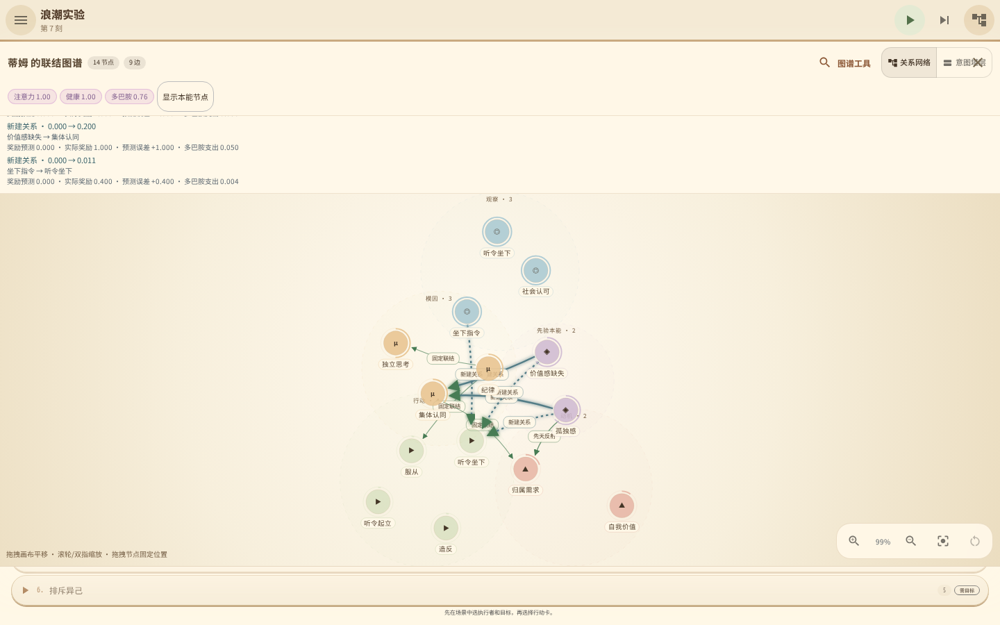
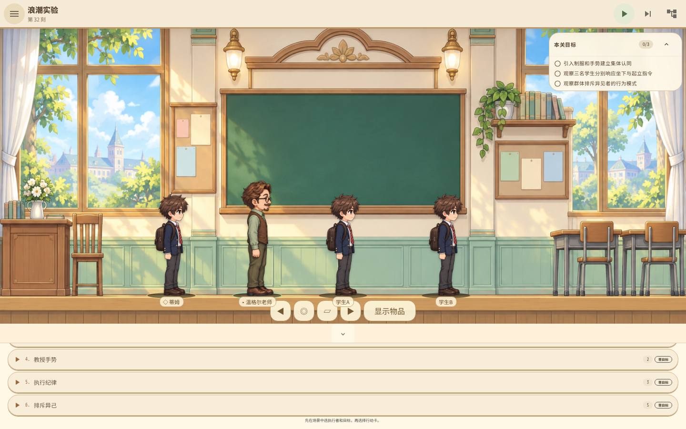

# 本地验证：浪潮的动作认可与价值需求

代码 `ec0c394f86632bbdbdf5c18e0d49b81a9a7bd413`。本批仅在开发机构建、测试，未运行 GitHub CI、未发布新安装包。
前一批三平台安装器不包含本页改动。

## 已验证的变化

认可必须对应指定学生近期真实完成、尚未奖励的教师指令动作。
仅选中动作、手动摆姿势、奖励其他学生、重复排队或恢复已保存的消费收据，都不能重复领取同一成果。
认可实际缓解孤独与价值匮乏；需求后果再按预测误差、真实多巴胺预算学习到该动作。
已有的自我价值动机保留，不把它简单当作需要下降的匮乏值。

试玩浪潮时，暂停游戏并在手册关闭自动步进。选择老师与蒂姆，依次引入制服、教授手势，
每个命令后步进一次；请坐后步进四次，看到实际坐姿后立即给予认可并步进一次。
认可随后不再可用。请起立并等待实际站起，才有下一次可奖励的成果。
打开联结图谱查看需求到群体认同、需求／指令到具体动作的付费学习记录。
对学生 A、B 分别操作，不能借用蒂姆的动作证据。

目标卡片改用可读的深棕／深绿色文字，中英键盘操作及对比度回归通过。

## 本地证据

- TypeScript 检查、72 项前端测试、正式素材检查、生产网页构建通过。
- Rust 格式、Clippy（警告视为错误）、134 项测试通过；BDD 为 22 场景／128 步。
- 21 关现有 MCP 路线通过；浪潮 tick40 完成三名学生的六次实际站坐及对应奖励。
- Chromium 桌面／手机 46 组视口通过，生成 125 张成功流程截图，无未捕获浏览器错误。
- [浏览器完整报告](browser-report.json)、[全部关卡报告](all-levels.json)、[核心测试日志](core-tests.log)。本页保留两张关键截图，其余临时截图已清理，可本地重跑生成。

首次动作奖励中，两个需求各实际缓解 0.2，动作学习总计支出 0.012 多巴胺；
需求到群体认同的两条新边另各支出 0.05。跨一整步的需求净变化为 0.195，包含自然需求增长。
等待 20 步不会再领奖，新一次实际起立才能获得下一次动作认可。

本机已构建网页位于 `intention-tower-game/dist/`，核心位于现有 scratch 编译目录。
需要在本机试玩时，在 `intention-tower-game` 目录分别启动：

```sh
/var/lib/mwc/build-scratch/cargo-target/debug/examples/intention-tower-mcp
```

```sh
node scripts/serve-playtest.mjs
```

浏览器打开 `http://127.0.0.1:4173`。远程开发机需转发 4173 与 9222 端口。
这是当前开发机的已构建结果，不是新的跨平台发行包；清除缓存后需按项目脚本重新本地构建。

群体主动排斥真实外人、撤除老师后的自主维持、奖励减弱后的动作消退仍未完成。
21 关路线通过不代表完整 Wiki 行为设计或商店上架条件已经满足。




