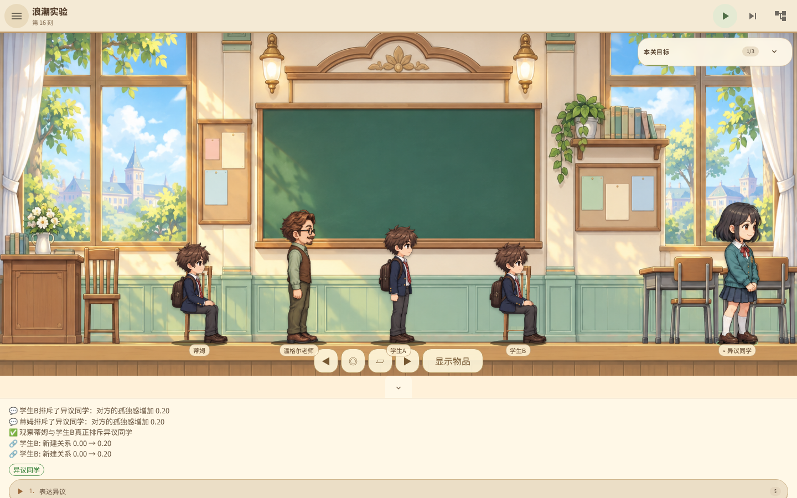
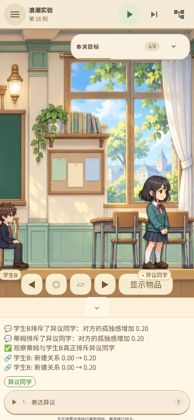

# 本地试玩：浪潮的真实排斥

代码：`b8dcd8c41587479bba5dc1ecc1ad6af70aabb224`。
仅本地构建测试，未使用 GitHub CI，未推送或发布新的跨平台安装器。
此前的安装包不包含本批改动。

## 启动本机已构建版本

在 `intention-tower-game` 目录分别启动两个进程：

```sh
/var/lib/mwc/build-scratch/cargo-target/debug/examples/intention-tower-mcp
```

```sh
node scripts/serve-playtest.mjs
```

打开 `http://127.0.0.1:4173`。远程开发机需转发 4173 和 9222 两个端口。
网页已构建在 `intention-tower-game/dist/`，核心使用开发机原有 scratch 编译目录，没有迁移缓存。
若开发机清除了该构建目录，需要重新按项目的本地构建流程生成核心。

## 试玩步骤

1. 进入浪潮实验，暂停并在手册关闭自动步进。
2. 先选异议同学，执行“表达异议”并步进数次：未学习的成员不会凭空排斥她。
3. 重新进入关卡。选择老师、以蒂姆为目标：引入制服、教授手势，各步进一次。
4. “请坐”后步进四次，确认实际坐下；随后给予认可并步进一次。
5. 对学生 B 重复上述训练。打开联结图谱，可检查需求到群体认同、需求／指令到动作的实际付费学习。
6. 改选异议同学，表达异议并步进两次。成员分别执行排斥，事件区显示真实对象及需求后果。

本次浏览器记录中，两名成员各增加异议同学 0.20 孤独感，总计 0.40。
异议同学保留为独立角色，并非教师注入的一条“拒绝”记录。
她复用已有 GPT Image 2 正式全身素材，不是本批新生成的独占人物或动作帧。
手机镜头跟随选中的角色；所有人物仍在同一地面高度。

此段流程验证排斥目标，不代表其余目标自动完成。完整路线还要求三名学生各自完成真实站坐与奖励。
当前排斥由异议线索触发，不应当理解为已完成撤除教师后的自主群体维持。

## 验证与边界

- 143 项 Rust 测试，22 个 BDD 场景／128 步，77 项 UI 测试通过。
- TypeScript、Clippy、格式、正式素材检查和生产网页构建通过。
- 21 关现有 MCP 路线通过；浪潮第 47 步完成六次站坐与两次真实排斥。
- Chromium 46 组桌面／手机视口通过，127 张截图，无未捕获异常。
- 修复新反馈被旧滚动位置遮住的问题；两种尺寸均验证后果文本实际可见、字号至少 13px。

[浏览器报告](browser-report.json)、[21 关路线报告](all-levels.json)、[核心测试日志](core-tests.log)。
仅保留下列两张关键截图，其余过程截图可重新运行本地验证脚本生成。

21 关路线通过仍不等于全部 Wiki 设计完成或已达到商店上架条件。
奖励减少后的动作消退、撤除教师后的群体维持、其余关卡语义及发行签名等仍在待办中。




