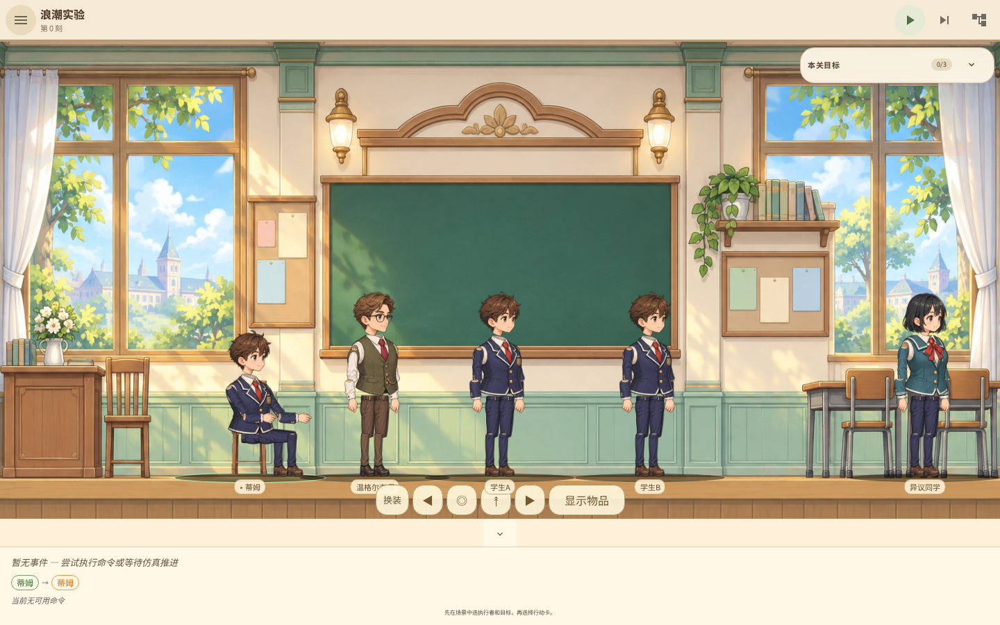
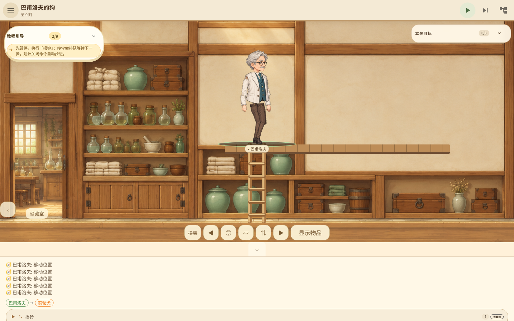

# 本地试玩：统一纸娃娃与连续房间

这是「实验犬的意义之塔」开发分支 `codex/production-art-playtest` 的本地可玩版本。
验收代码：`5bfde589b2f144ac191370e752551292bcb75ec2`。
本轮没有发布新安装器，也没有使用 GitHub CI。旧安装包不包含本轮改动。

## 启动

在仓库的 `intention-tower-game` 目录分别运行：

```sh
/var/lib/mwc/build-scratch/cargo-target/debug/examples/intention-tower-mcp
```

```sh
node scripts/serve-playtest.mjs
```

浏览器打开 <http://127.0.0.1:4173>。远程环境需要同时转发 4173 和 9222 端口。
已构建网页位于 `intention-tower-game/dist/`，核心位于开发机原有 scratch 编译目录。
这两个构建产物不是源码的一部分；换到另一台机器需重新本地构建。

## 这次可以试什么

1. 进入「浪潮实验」，暂停自动步进，点击蒂姆选中。
2. 底部“换装”可切换服装；头部身份保持不变。不同角色共用四头身骨架和动作。
3. 点击坐姿按钮坐下，再点击场景左侧空处，角色会起身沿地面行走。
   点击高度不改变角色地面高度。手机镜头跟随选中角色。
4. 进入「巴甫洛夫的狗」，选择巴甫洛夫。使用右移或房间边缘的入口按钮走入储藏室，
   镜头连续平移；不会重载关卡或重置实验犬的学习。
5. 在储藏室走到梯子旁，点击“⇅”上阁楼，再点击下楼，最后从左侧返回实验室。
6. 原有摇铃、喂食、独立测试与联结图谱仍可使用。

纸娃娃的四种头型、四套服装是第一批共享正式素材，不是所有角色的最终独占造型。
动物暂未纳入人形骨架；复杂关卡的地图迁移、独立攀爬动作和真机验收仍在待办。

## 验证

158 项 Rust 测试、22 个 BDD 场景／128 步、93 项 UI 测试通过。
21 关现有路线和 46 组浏览器视口通过，但不代表所有 Wiki 设计及商店发行条件已完成。

[浏览器报告](browser-report.json) · [21 关路线](all-levels.json) · [核心测试日志](core-tests.log)





