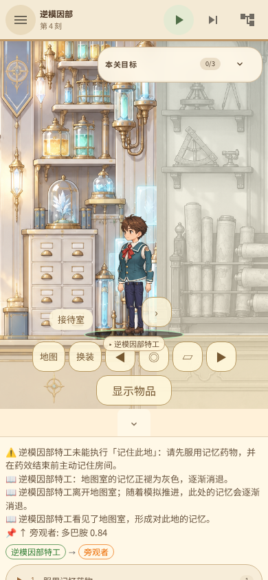
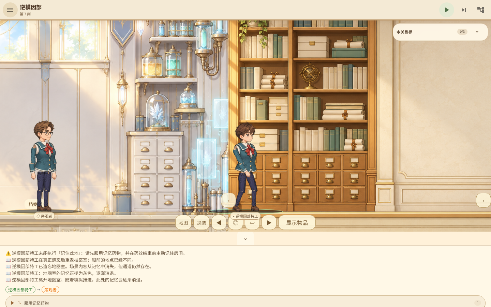
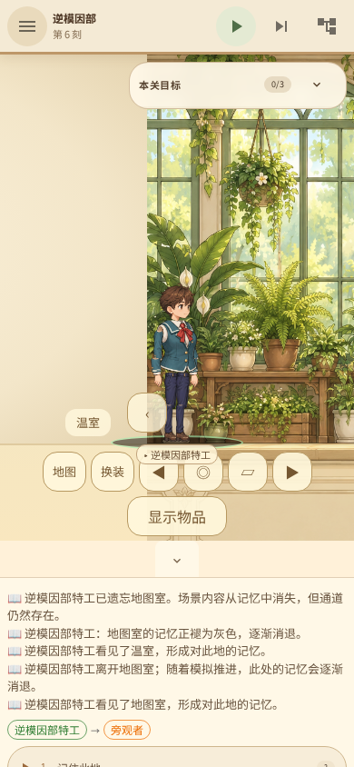

# 本地试玩：逆模因部的连续地图与地点记忆

「实验犬的意义之塔」开发分支 `codex/production-art-playtest`。
这是使用正式 GPT Image 2 背景和共享纸娃娃的本地网页＋Rust 核心版本，
不是已发布安装器；本轮没有运行 GitHub CI。

## 启动

在 `/home/user/workspace/intention-tower/intention-tower-game` 下分别运行：

```sh
/var/lib/mwc/build-scratch/cargo-target/debug/examples/intention-tower-mcp
```

```sh
node scripts/serve-playtest.mjs
```

打开 <http://127.0.0.1:4173>。远程开发环境需要同时转发 4173 和 9222。
网页构建位于 `intention-tower-game/dist/`；核心位于开发机原有 scratch 目录，
没有把编译缓存搬进工作卷。换机后这两个本地产物需要重新构建。

## 可以实际尝试的流程

1. 进入「逆模因部」，选中特工，切换微操。默认暂停，行走不会暗中推进模拟时间。
2. 从接待室右侧通道进入第二个房间。它可能呈现为地图室或档案室；地图、标题、
   入口名称和地点记忆均跟随实际身份。进入、离开和重访都会即时显示提示。
3. 返回接待室，按顶部单步按钮推进：前两步仍为彩色，第 3 步褪灰，第 6 步遗忘。
   遗忘后背景和该房间内容隐藏，但通道可通行。
4. 再次走入，地点外观和对应观察节点都发生变化。单纯来回移动、不推进时间，
   不会制造“遗忘后重访”的进度。
5. 返回接待室，走到旁观者附近，用“选择目标”按钮选中旁观者，
   在观察模式询问地点，取得对真实重访的证言。
6. 服用记忆药物，在 40 步药效窗口内进入希望保留的房间，并执行“记住此地”。
   单独服药、没有药物直接记忆，或药效到期后再记忆，都不能形成有效锚点。
7. 离开至少 6 步再返回：锚定的地点保持不变，完成此关。

第二个房间的右侧还连着第三个房间，可在通关前继续探索；两个地点各自记忆、
褪灰和遗忘，不会因为另一个房间变了就一起重置。底部“地图”可查看状态和药效。
胜利后会正常显示结算并停止操作；想继续自由试验可重新开始本关。

「巴甫洛夫的狗」仍可由实验室走入储藏室，上下阁楼，再走回；手机窄屏已实际
点按入口、左右移动和梯子按钮验证。人形共用纸娃娃骨架、换装及站坐行走逻辑。

## 设计边界

地点变化属于观察者的记忆与感知，不会偷偷删除其他人物或重置物品、地面和连接。
初始身份由种子决定，目前每个记忆房间只有两种变体，重访变化较可预测；
更丰富的变体及随机组合仍在待办。未把这次通过当作其余关卡的全部 Wiki 语义完成。
动物共用动作、更多职业头发服装、复杂关卡迁移、真机性能和上架条件仍需继续。

## 验收证据

核心与 UI 日志、实际浏览器截图及机器报告保存在本目录。
自动化由实际 Chromium 操作构建后的页面，状态来自 Rust 核心，不使用模拟游戏后端。
手机证据是 390×844 浏览器视口，不等同于手机真机验收。

- Rust 179 项测试；BDD 22 场景／128 步；UI 110 项测试通过。
- 21/21 关现有 MCP 路线通过。
- 46 个浏览器关卡／视口用例、166 次字体检查通过，无浏览器异常。
- 逆模因部桌面和手机各 14 个阶段通过，另覆盖手机三房间双向往返与独立遗忘。
- 两处入口的即时提示、药物单独无效、无药无法锚定、锚定后长时间离开仍保持均通过。

[浏览器报告](browser-report.json) · [地点记忆报告](room-memory-report.json) ·
[21 关路线](all-levels.json) · [核心测试](core-tests-final.log) · [UI 测试](ui-tests-final.log)

本目录保留 9 张关键截图；完整 184 张过程截图不长期重复存储，
可用 `scripts/verify-browser-mcp.mjs` 和 `scripts/verify-room-memory-mcp.mjs` 重现。






