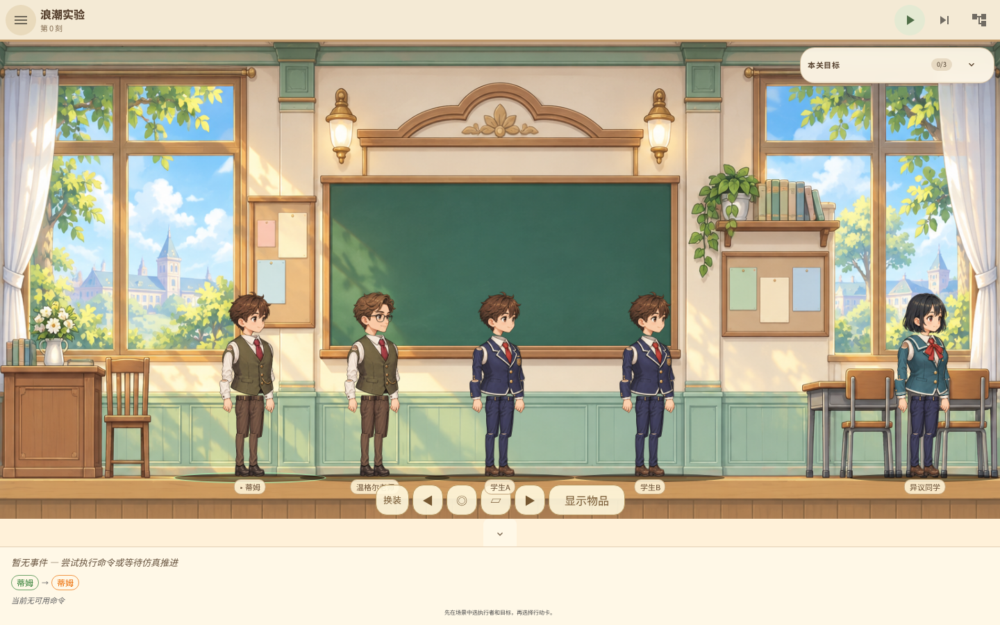
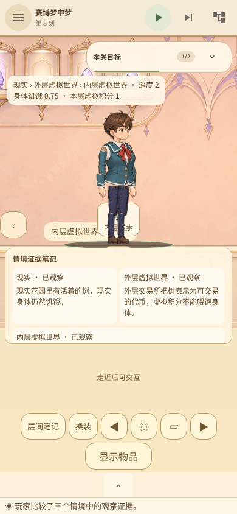

# 本地试玩：赛博梦中梦

「实验犬的意义之塔」开发分支 `codex/production-art-playtest`。
现实、外层虚拟世界、内层虚拟世界各有两个可步行房间，使用正式 GPT Image 2
背景和同一个可换装纸娃娃。进入梦境不会换掉人物、清空思维图谱或重置世界。
本轮仅本地构建与测试，没有发布新安装器，没有运行 GitHub CI。

当前验收未全部通过：320×500 矮屏打开层间笔记失败，PR 暂不合并。
390×844 的六房间完整旅程通过。层级场景报告保留失败状态，
不能将这些截图理解为所有手机尺寸均已验收。

## 启动

在 `/home/user/workspace/intention-tower/intention-tower-game` 下分别运行：

```sh
/var/lib/mwc/build-scratch/cargo-target/debug/examples/intention-tower-mcp
```

```sh
node scripts/serve-playtest.mjs
```

打开 <http://127.0.0.1:4173>；远程开发环境需要同时转发 4173 和 9222。
本地网页构建在 `intention-tower-game/dist/`，核心仍在开发机原有 scratch 目录。
换机需要重新本地构建；源码中的旧安装包不代表这次版本。

另有本地 Linux 试玩包 `intention-tower-linux-playtest-20261105.tar.gz`：
解压后按包内 `README.md` 启动 Rust 核心和网页服务，需要 Linux 与 Node 22+，
无需安装前端依赖或重新编译。它包含上述已知问题，不是签名安装器。

## 游玩步骤

默认暂停，行走不会推进模拟。微操中点击物件标记可走近，底部显示当前可用行动。
默认行动可自动步进；若关闭自动步进，执行后按顶部单步按钮结算。

1. 从现实工作室向右走进庭院，走近“现实线索”并观察，记录现实身体仍会饥饿。
2. 返回工作室，在终端旁进入外层虚拟世界。跨层只能通过附近终端，不能远距离进入。
3. 向右探索外层交换厅，观察线索。可以取得虚拟奖励，但它不会降低现实身体饥饿。
4. 继续走到外层终端，进入内层虚拟世界。向右探索档案厅，观察第三份线索。
5. 比较三层证据。底部“层间笔记”保留实际观察内容，而非仅记录按钮按了几次。
6. 回到内层入口的返回终端，先退到外层原先位置；再走回外层入口，返回现实。
   每次只能退出一层，人物的位置、观察记录和思维状态持续保留。
7. 回现实庭院走近餐食，执行满足现实需求。实际消耗一份食物，
   身体饥饿从 0.75 降至 0.15 后完成此关。

手机笔记本打开时会收起对话区，保留人物完整显示；重新开始同一关会关闭旧笔记本。
旧版单地图存档会明确提示迁移，保留人物心智并归档旧进度，但不会把旧计数当成
真实跨层经历；原存档文件不会自动覆写。

## 验收与边界

193 项 Rust 测试、123 项 UI 测试、Clippy、生产构建及正式素材校验通过。
21 个关卡核心通关脚本通过；这不等于其全部 Wiki 机制已经完成。
重复 BDD 框架已移除，规则以 Rust 专项测试为准。
真实 Chromium 验收区分桌面／手机的关键界面交互和手机六房间完整流程，
固定地面高度、共享人物、附近终端、逐层返回、虚拟奖励无身体收益、真实进食，
以及未满足前提的拒绝操作。笔记本打开时另校验人物不被截断、按钮至少 44px、
没有未翻译的命令键。

此关目前用固定三层和一次真实进食表达“现实的意义”，不是无限生成世界，
也不是已完成全部自主价值选择。其他 Wiki 关卡、动物动作、真机性能、
发行签名与商店材料仍在待办。主 JS 包偏大，后续还需拆分。

四张新背景与两张复用背景的来源、提示和散列见
`docs/art/cyber-layer-prompts.md` 及素材 `provenance.json`。
新背景通过用户指定的 `proxy-imagegen` 上游生成；成功素材没有重复生成。






报告：`browser-report.json`、`room-memory-report.json`、`all-levels.json`、
`layered-world.json`。最后一份明确记录矮屏失败及此前通过的完整旅程。
